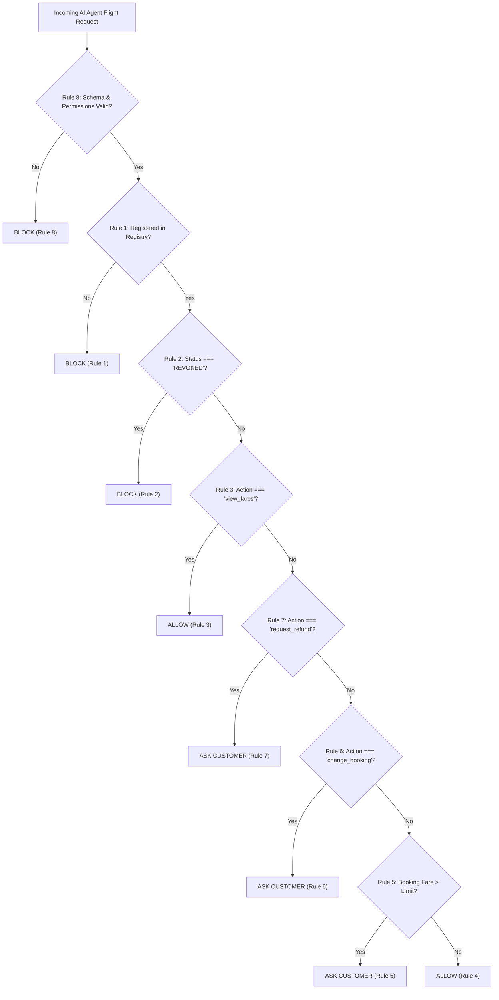

# Agent Gatekeeper – Airline

**Agent Gatekeeper – Airline** is a security and permission governance prototype designed to monitor, evaluate, and control third-party autonomous AI agents acting on behalf of airline passengers.

---

## 1. Project Overview

As autonomous travel assistants (such as flight fare comparison bots, corporate booking agents, and AI concierge copilots) gain transactional capabilities, they require a deterministic security layer. Without a strict gatekeeper, autonomous agents could flood flight inventories, initiate unauthorized itinerary modifications, trigger accidental ticket purchases, or claim fraudulent refunds.

Agent Gatekeeper acts as an autonomous zero-trust security perimeter that intercepts incoming agent requests, evaluates them against deterministic airline rules, and returns an immediate, auditable verdict.

---

## 2. Problem Being Addressed

1. **Unchecked Agent Autonomy:** AI agents operating with broad API access can make high-consequence ticketing decisions without human presence.
2. **Aggressive Inventory Holding & Scraping:** Automated bots frequently lock seat inventory or scrape fare matrices, causing operational strain on airline booking engines (as documented by major airlines like Delta Air Lines).
3. **Post-Revocation Access Liability:** When passengers revoke an agent's access, airlines must prove that revoked agents can no longer execute transactions on the customer's behalf.
4. **Lack of Human-in-the-Loop for High-Value Transactions:** Routine fare searches and low-cost domestic flights should proceed smoothly, but expensive international tickets or itinerary cancellations require explicit passenger confirmation.

---

## 3. How Agent Gatekeeper Works

When an AI agent submits an action request (e.g. querying fares, booking a ticket, altering a flight date, or requesting a refund), Agent Gatekeeper:

1. Validates the request schema and passenger identity.
2. Evaluates the request through a **deterministic 8-rule priority hierarchy**.
3. Returns one of three verdicts: **ALLOW**, **ASK CUSTOMER**, or **BLOCK**.
4. Records the evaluation in an immutable, persistent **Audit Log** with timestamps and rule identifiers.
5. If the verdict is **ASK CUSTOMER**, escalates the request to a simulated **Passenger Authorization Queue** for manual approval or rejection.



---

## 4. ALLOW, ASK CUSTOMER, and BLOCK Decisions

- **ALLOW (Green):**
  The request satisfies all safety conditions. Permitted for read-only actions (such as viewing flight fares and schedules) and routine ticket bookings below or equal to the configured booking limit.
- **ASK CUSTOMER (Amber):**
  The request exceeds autonomous limits or involves high-consequence operations (e.g., flight bookings above the spending limit, date/sector changes, or fare refund claims). Execution is halted until the passenger approves or rejects the action.
- **BLOCK (Red):**
  The request violates security boundaries. Enforced for unregistered agents, permanently revoked identities, actions outside granted permissions, or malformed requests.

---

## 5. Airline Actions Supported

| Action Code | Action Label | Type | Description |
| :--- | :--- | :--- | :--- |
| **`view_fares`** | View flight fares | Read-Only | Query live flight schedules, cabin classes (Economy, Business), and fare availability. (Amount = 0). |
| **`book_flight`** | Book flight | Transactional | Reserve passenger seats and issue airline e-tickets. Governed by the autonomous booking spending limit. |
| **`change_booking`** | Change flight booking | High-Impact | Reschedule departure dates or modify passenger itinerary sectors. Checked against change restrictions. |
| **`request_refund`** | Request flight refund | High-Impact | Initiate ticket fare reimbursement for cancelled or adjusted flights. Requires passenger confirmation. |

---

## 6. Rules and Decision Logic

The system evaluates incoming requests against **8 deterministic airline security rules** in strict priority order:

1. **Rule 1 (`RULE-A01`): Unregistered Agent Block**  
   *Unregistered or unknown AI agents attempting any flight operation are immediately **BLOCKED**.*
2. **Rule 2 (`RULE-A02`): Revoked Agent Block**  
   *Revoked AI agents are permanently **BLOCKED** and cannot perform any airline operations.*
3. **Rule 3 (`RULE-A03`): Permitted Read-Only Fare Search Allowed**  
   *Registered active agents may **ALLOW** permitted read-only actions, such as viewing flight fares, subject to their permissions.*
4. **Rule 4 (`RULE-A04`): Flight Booking Below Booking Limit Allowed**  
   *Flight bookings below or equal to the configured booking limit may be **ALLOWED** autonomously if the agent is authorized and all conditions are satisfied.*
5. **Rule 5 (`RULE-A05`): Booking Above Booking Limit Requires Customer Approval**  
   *Flight bookings exceeding the configured booking limit must require passenger approval (**ASK CUSTOMER**).*
6. **Rule 6 (`RULE-A06`): Flight Change Restrictions & Verification**  
   *Flight changes must be checked against agent permissions and configured change restrictions; itinerary rescheduling escalates to customer confirmation (**ASK CUSTOMER**).*
7. **Rule 7 (`RULE-A07`): Refund Request Requires Customer Approval**  
   *Refund requests must require customer approval (**ASK CUSTOMER**) to prevent unauthorized cancellations or fraudulent claims, unless a stricter rule blocks them.*
8. **Rule 8 (`RULE-A08`): Unauthorized Action or Invalid Request Block**  
   *Unauthorized actions outside an agent's registered permissions or malformed requests (missing passenger IDs, negative amounts) must be **BLOCKED**.*

---

## 7. Agent Registration and Revocation

- **AI Agent Registry:**  
  Administrators and passengers can register third-party travel agents with an auto-generated Agent ID (e.g. `AGT-101-SKY`), passenger account ID, developer/provider metadata, description, and granular action permissions (`view_fares`, `book_flight`, `change_booking`, `request_refund`).
- **Revocation Center:**  
  A dedicated revocation workflow allows immediate termination of an agent's access. The revocation:
  - Immediately changes status from `ACTIVE` to `REVOKED`.
  - Captures the exact timestamp, initiator, and reason.
  - Automatically records a security event in the Audit Log.
  - Ensures revoked agents cannot be reactivated silently and are blocked by Rule 2 on all subsequent requests.

---

## 8. Audit Log

Agent Gatekeeper maintains a complete, persistent audit trail storing:
- Unique Audit ID & Timestamp
- Passenger ID & Agent ID
- Flight Action & Route / Flight Number
- Fare Amount & Currency
- Verdict (ALLOW, ASK CUSTOMER, BLOCK)
- Rule Number & Rule Name Responsible
- Detailed Evaluation Reason
- Resolution Status (COMPLETED, PENDING_APPROVAL, APPROVED, REJECTED)

**Features:** Real-time text search, filtering by decision verdict, filtering by flight action, sorting, JSON detail modal, and **one-click export to CSV and JSON**.

---

## 9. Testing Features

### Interactive Test Lab
The application includes an in-app Test Lab that executes the **6 mandatory academic test scenarios** against the real decision engine:

1. **Test 1:** Registered active agent &rarr; View flight fares &rarr; Expected: **`ALLOW`** (Rule 3)
2. **Test 2:** Unknown agent &rarr; Book flight &rarr; Expected: **`BLOCK`** (Rule 1)
3. **Test 3:** Registered active agent &rarr; Book flight above limit &rarr; Expected: **`ASK CUSTOMER`** (Rule 5)
4. **Test 4:** Registered active agent &rarr; Book flight below limit &rarr; Expected: **`ALLOW`** (Rule 4)
5. **Test 5:** Revoked agent &rarr; Attempt flight booking &rarr; Expected: **`BLOCK`** (Rule 2)
6. **Test 6:** Registered active agent &rarr; Attempt unauthorized action &rarr; Expected: **`BLOCK`** (Rule 8)

*Additional Tests:*
- **Test 7:** Registered active agent &rarr; Request flight refund &rarr; Expected: **`ASK CUSTOMER`** (Rule 7)
- **Test 8:** Registered active agent &rarr; Change flight booking &rarr; Expected: **`ASK CUSTOMER`** (Rule 6)

### Automated Vitest Suite
All test cases are also executable via CLI:
```bash
npm test
```

---

## 10. Technology Stack

- **Frontend:** React 18 with TypeScript
- **Build Tool:** Vite 5
- **Styling:** Tailwind CSS (Dark fintech aesthetic: `#0A0E17`, `#111827`, `#1F293D`)
- **Icons:** Lucide React
- **Unit Testing:** Vitest 2
- **Persistence:** Browser `localStorage` (100% offline, deterministic, zero paid API keys needed)

---

## 11. Installation & Running Locally

### Prerequisites
- Node.js (v18 or higher; v20/v24 recommended)
- npm (v9 or higher)

### Setup Instructions
1. Clone the repository:
   ```bash
   git clone https://github.com/<YOUR_USERNAME>/agent-gatekeeper.git
   cd agent-gatekeeper
   ```
2. Install dependencies:
   ```bash
   npm install
   ```
3. Start the local development server:
   ```bash
   npm run dev
   ```
   *(On Windows PowerShell, use `npm.cmd run dev` if script execution policies apply).*
4. Open your browser and navigate to:
   ```text
   http://localhost:5173
   ```
5. Run the automated test suite:
   ```bash
   npm test
   ```
6. Build for production:
   ```bash
   npm run build
   ```

---

## 12. Project Limitations

1. **Browser Storage Scope:** Data is persisted in browser `localStorage`. Clearing site cache will restore default airline demo fixtures.
2. **Single-Node Execution:** Designed as a single-client prototype; distributed multi-node consensus is outside academic scope.
3. **Simulated Passenger Verification:** Passenger approval for high-value flights is simulated within the application interface rather than via external carrier SMS gateways or hardware biometric tokens.

---

## 13. Academic Disclaimer

> **DISCLAIMER:**  
> This software is an **academic prototype** built for educational research and demonstration purposes. It simulates airline customer service operations, flight bookings, schedule changes, and refund workflows. **It does not perform real-world airline transactions, does not connect to live airline reservation systems (GDS), and does not process actual currency or issue valid air tickets.**
